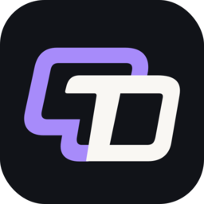
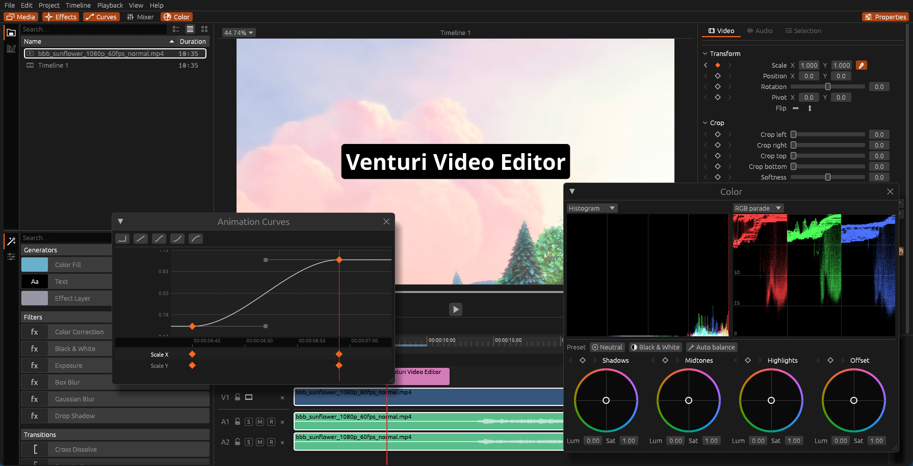

<div align="center">



# Tandem

**A video editor where AI works with you, not for you.**

Built for free AI assisted video editing.

[](LICENSE)
[](https://rustup.rs)

[Website](https://venturivideo.github.io/Venturi/) •
[Discord](https://discord.gg/3v2xjXFnZv) •
[Features](#features) •
[Build from source](docs/BUILDING.md) •
[AI Sequence Generator](docs/AI_SEQUENCES.md) •
[Architecture](ARCHITECTURE.md) •
[Contributing](#contributing)



</div>

---

Tandem keeps the workflow you already know from CapCut
while having AI help you reach your vision as quick as
possible. Tools like AI Clips and Auto Cutting help you
express your creativity without fighting with tools or
have AI make slop for you.

---

## Features

- **Fast playback and scrubbing.** Timeline-wide frame cache, optional
  background proxies, playback up to 8x with pitch-preserved audio, best in class.
- **Hardware accelerated.** Decoding on NVDEC, Vulkan video or VideoToolbox,
  compositing on the GPU (Vulkan, Metal), export on NVENC, Vulkan or
  VideoToolbox, with software as the fallback.
- **Professional timeline workflow.** Track scrubbing with audio, ripple
  delete, compound clips, copy/paste properties, copy/paste of clips and
  media between projects and Tandem windows, magnet snapping, clip speed
  from 1% to 10,000%, unlimited undo with a jumpable history.
- **A library shared by all projects.** Media and compound clips you reuse
  everywhere, and property presets (a 2x punch-in with its easing, a drop
  shadow, a voice level) applied with a drag or a shortcut, timed from the
  start or the end of any clip.
- **Audio, finished in place.** A mixer with per-track and master gain,
  balance, meters and an effect chain: 6-band equalizer and 3-band
  multiband compressor over the live spectrum, normalization (sample
  peak, true peak or EBU R128 loudness, per clip or per track), mono,
  VST3 plugins (macOS and Linux).
  Voiceover recorded straight onto the timeline.
- **Keyframes done right.** Every parameter is keyframable: crop, zoom,
  rotation, position, speed, opacity, audio gain. A dedicated curve editor
  with custom curves.
- **Titles, solid colours, filters, transitions.** Applied straight from the
  timeline, no node graph to wire up.
- **Color correction.** Shadows, midtones, highlights and offset wheels,
  auto balance and GPU scopes (waveform, RGB parade, vectorscope,
  histogram), composed in 16-bit float.
- **Drivable by AI agents.** A built-in MCP server lets an agent such as
  Claude Code import, cut, measure audio, look at frames and export, on its
  own or in the window you are editing. See [docs/MCP.md](docs/MCP.md).
- **Budget friendly AI.** Features can be used by Claude Code, Codex, OpenCode
  and free Gemini API. Not needing to pay massive API costs and still
  getting the full experience.
- **AI Clips.** Chooses the best moments from your long videos and puts
  them in your timeline, ready to post.
- **AI Infographics.** Describe your idea and have AI generate it, or
  just let AI choose where it would help out your video.
  
## Install

On Linux (x86_64 or aarch64), download and run the
[installer](https://github.com/VenturiVideo/Venturi/releases/latest/download/install.sh):

```sh
curl -fL https://github.com/cpstest-tech/Venturi/releases/latest/download/install.sh -o install.sh
bash install.sh
```

The downloaded installer stays pinned to that release; use
`bash install.sh latest` to install a newer release later.

The installer requires Bash, curl and tar. It installs the release's AppImage as
`~/.local/bin/tandem` and adds Tandem to your application menu, without sudo.
Pass a release tag such as `bash install.sh v0.9.0` to select a version
(releases before the installer existed are not supported). Set `INSTALL_DIR` to
choose another binary directory; desktop entries respect `XDG_DATA_HOME`.
Add the binary directory to your `PATH` to run `tandem` from the terminal.
To uninstall, run `bash install.sh --uninstall` with the same `INSTALL_DIR`
and `XDG_DATA_HOME` settings used for installation. This removes the binary,
menu entry, icons and MIME registration; your projects are preserved.

AppImages may require FUSE 2; without it, run
`tandem --appimage-extract-and-run`.

For macOS, Windows or a manual Linux installation, grab the latest build from the
[Releases](https://github.com/VenturiVideo/Venturi/releases/latest) page:

| Platform | File | Notes |
|---|---|---|
| Linux x86_64 / aarch64 | `Tandem-<arch>.AppImage` | FFmpeg bundled. Needs a Vulkan driver. |
| macOS (Apple Silicon) | `Tandem-arm64.dmg` | Ad-hoc signed, see [first launch on macOS](docs/BUILDING.md#opening-the-app-on-another-mac). |

```sh
chmod +x Tandem-x86_64.AppImage
./Tandem-x86_64.AppImage
```

To build from source, see [docs/BUILDING.md](docs/BUILDING.md).

## The name

Tandem, just like the bike. You're working and controlling your
creative projects while AI works in the back to make you faster.

## Contributing

Issues and pull requests are welcome. For questions, feedback and feature
ideas, join the [Discord server](https://discord.gg/3v2xjXFnZv). Before
opening a PR:

```sh
cargo fmt
cargo clippy --all-targets -- -D warnings
cargo test --workspace
```

The `CI` workflow runs the same three steps on every pull request. Unit tests
live in `crates/<crate>/src/tests/`, not inline, see
[Where unit tests live](docs/BUILDING.md#where-unit-tests-live). The full
conventions (for humans and coding agents alike) are in [CLAUDE.md](CLAUDE.md)
and [AGENTS.md](AGENTS.md); the design is in [ARCHITECTURE.md](ARCHITECTURE.md).

## Licence

GPL-3.0-or-later, see [LICENSE](LICENSE).
